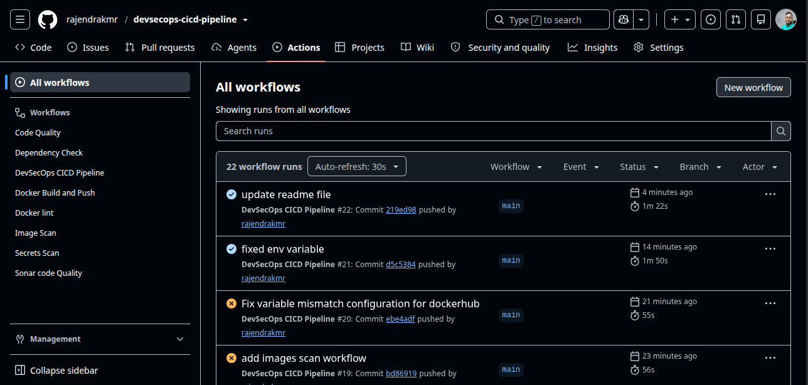
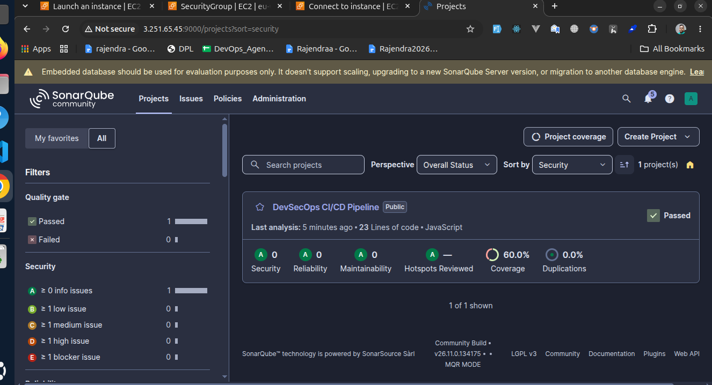
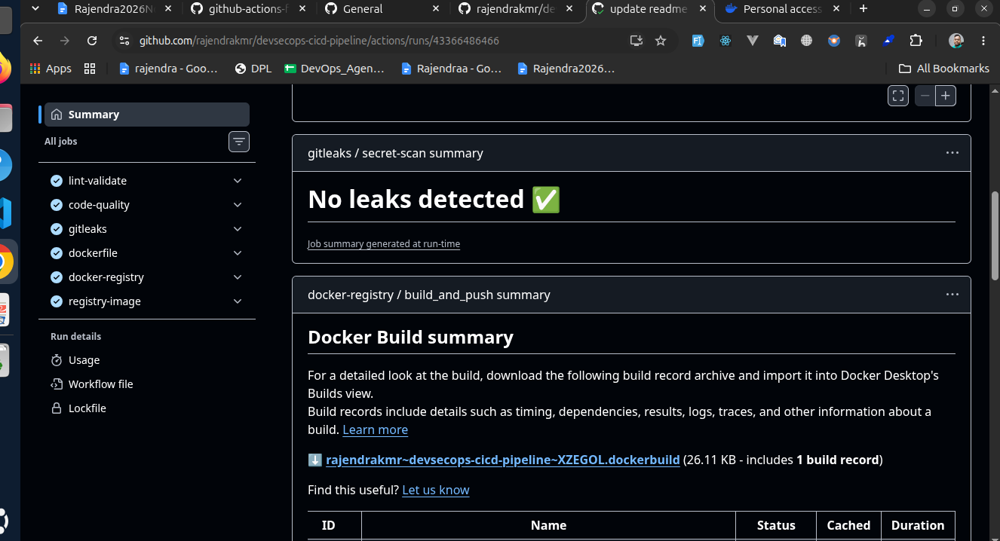

# DevSecOps CI/CD Pipeline

An end-to-end **DevSecOps CI/CD Pipeline** for a Node.js (Express) application using GitHub Actions and reusable workflows.

The pipeline integrates automated code quality checks, static application security testing (SAST), secret detection, dependency scanning, Dockerfile linting, container image building, and vulnerability scanning.

It uses a **self-hosted GitHub Actions runner** for executing CI/CD jobs and Docker-based SonarQube for code quality analysis.

---

## Architecture

```text
                 Developer
                     |
                     | Push to main
                     v
              GitHub Repository
                     |
                     v
             GitHub Actions Pipeline
                     |
        +------------+-------------+
        |            |             |
        v            v             v
   Code Quality   SonarQube     Gitleaks
   (ESLint)       (SAST)        (Secrets Scan)
        |            |             |
        +------------+-------------+
                     |
              Dockerfile Lint
                     |
                     v
             Security Gates Passed
                     |
                     v
             Docker Build & Push
                     |
                     v
                Docker Hub
                     |
                     v
              Trivy Image Scan
                     |
                     v
             Vulnerability Report
```

---

## Pipeline Workflow

The main workflow is defined in:

`.github/workflows/devsecops.yml`

It triggers automatically when code is pushed to the `main` branch.

### Workflow execution

| Stage | Workflow | Tool | Purpose |
|---|---|---|---|
| Code Quality | `code-quality.yml` | ESLint | JavaScript code quality and linting |
| Static Analysis | `sonar-quality.yml` | SonarQube | Bugs, vulnerabilities, code smells and quality gate |
| Secret Detection | `secrets-scan.yml` | Gitleaks | Detect accidentally committed secrets |
| Dockerfile Validation | `docker-lint.yml` | Hadolint | Dockerfile best practices and validation |
| Dependency Scanning | `dependency-check.yml` | OWASP Dependency-Check | Identify vulnerable dependencies |
| Docker Build & Push | `docker-build-and-push.yml` | Docker | Build and push container image |
| Image Scanning | `image-scan.yml` | Trivy | Scan container image for vulnerabilities |

### Pipeline dependency

The initial validation and security workflows execute independently.

Docker image creation starts only after the required validation jobs succeed.

Trivy scans the image after it has been pushed to Docker Hub.

---

## Project Structure

```text
devsecops-cicd-pipeline/
│
├── .github/
│   └── workflows/
│       ├── code-quality.yml
│       ├── dependency-check.yml
│       ├── devsecops.yml
│       ├── docker-build-and-push.yml
│       ├── docker-lint.yml
│       ├── image-scan.yml
│       ├── secrets-scan.yml
│       └── sonar-quality.yml
│
├── src/
│   ├── app.js
│   └── server.js
│
├── tests/
│   └── app.test.js
│
├── Dockerfile
├── .dockerignore
├── .gitleaks.toml
├── sonar-project.properties
├── package.json
├── package-lock.json
└── README.md
```

---

## Technologies Used

| Category | Technology |
|---|---|
| Application | Node.js, Express.js |
| CI/CD | GitHub Actions |
| CI/CD Runner | Self-hosted Ubuntu Runner |
| Code Quality | ESLint |
| SAST | SonarQube |
| Secret Scanning | Gitleaks |
| Dependency Scanning | OWASP Dependency-Check |
| Dockerfile Linting | Hadolint |
| Containerization | Docker |
| Container Registry | Docker Hub |
| Container Security | Trivy |
| Testing | Jest, Supertest |

---

## SonarQube Setup Using Docker

SonarQube Community Edition is deployed locally using Docker with persistent volumes.

### 1. Create Docker volumes

```bash
docker volume create sonarqube_data
docker volume create sonarqube_extensions
docker volume create sonarqube_logs
```

### 2. Run SonarQube container

```bash
docker run -d \
  --name sonarqube \
  -p 9000:9000 \
  -e SONAR_ES_BOOTSTRAP_CHECKS_DISABLE=true \
  -v sonarqube_data:/opt/sonarqube/data \
  -v sonarqube_extensions:/opt/sonarqube/extensions \
  -v sonarqube_logs:/opt/sonarqube/logs \
  sonarqube:community
```

### 3. Access SonarQube

Open:

```text
http://localhost:9000
```

Default credentials:

```text
Username: admin
Password: admin
```

Change the default password after the first login.

Generate a SonarQube token from your account and configure it in GitHub repository secrets.

> Note: For a self-hosted runner on another machine, configure `SONAR_HOST_URL` with an address reachable from that runner. `localhost` works only when the runner and SonarQube are accessible on the same host/network namespace.

---

## Self-Hosted GitHub Actions Runner

This project uses a self-hosted Ubuntu runner to execute CI/CD workflows.

### Benefits

- Run workflows on your own infrastructure.
- Control the runner environment.
- Manage installed tools and dependencies.
- Execute Docker-related operations.
- Integrate with self-hosted services such as SonarQube.

### Runner setup

1. Open your GitHub repository.
2. Navigate to **Settings → Actions → Runners**.
3. Select **New self-hosted runner**.
4. Select Linux and follow the commands provided by GitHub.
5. Configure and start the runner.

Verify the runner status in GitHub:

```text
Repository → Settings → Actions → Runners
```

The runner should show as **Idle** when available.

---

## GitHub Repository Configuration

Configure the following values under:

**Settings → Secrets and variables → Actions**

### Repository Secrets

| Secret Name | Purpose |
|---|---|
| `SONAR_TOKEN` | SonarQube authentication |
| `SONAR_HOST_URL` | SonarQube server URL |
| `DOCKER_HUB_TOKEN` | Docker Hub authentication token |
| `NVD_API_KEY` | NVD API access for Dependency-Check |
| `GITLEAKS_LICENSE` | Optional, if required by your Gitleaks setup |

### Repository Variables

| Variable Name | Purpose |
|---|---|
| `DOCKERHUB_USERNAME` | Docker Hub username |

Use repository secrets for sensitive credentials. Never hardcode tokens or passwords in workflow files.

---

## Running the Pipeline

### 1. Clone the repository

```bash
git clone https://github.com/rajendrakmr/devsecops-cicd-pipeline.git

cd devsecops-cicd-pipeline
```

### 2. Install dependencies

```bash
npm ci
```

### 3. Push changes to main

```bash
git add .
git commit -m "Trigger DevSecOps pipeline"
git push origin main
```

### 4. Monitor execution

Navigate to:

```text
GitHub Repository → Actions
```

Check individual workflow jobs and their execution logs.

---

## Run Application Locally

Install dependencies:

```bash
npm ci
```

Run tests:

```bash
npm test
```

Start the application:

```bash
npm start
```

Health endpoint:

```text
http://localhost:3000/health
```

---

## Build Docker Image Locally

```bash
docker build -t devsecops-demo-app .
```

Run the container:

```bash
docker run -d \
  --name devsecops-app \
  -p 3000:3000 \
  devsecops-demo-app
```

Check running containers:

```bash
docker ps
```

---

## Security Practices Demonstrated

- **Shift-Left Security:** Run security checks early in the development lifecycle.
- **SAST:** Integrate SonarQube for static code analysis.
- **Secret Detection:** Use Gitleaks to identify exposed credentials.
- **Dependency Security:** Identify vulnerable third-party packages.
- **Dockerfile Security:** Validate Dockerfile best practices using Hadolint.
- **Container Security:** Scan Docker images using Trivy.
- **Reusable Workflows:** Maintain modular and reusable GitHub Actions workflows.
- **Self-Hosted Runner:** Execute CI/CD jobs using your own Ubuntu infrastructure.
- **Secure Credentials:** Store sensitive values in GitHub Secrets.
- **Non-Root Container:** Run the application with a non-root user.
- **Quality Gates:** Control image creation based on the required validation jobs.

---

## Pipeline Screenshots

Screenshots of successful workflow execution and security scan results can be added here.

Create the following directory:

```bash
mkdir -p docs/screenshots
```

Add your screenshots to that directory.

### 1. GitHub Actions Pipeline Overview



### 2. SonarQube Code Quality Analysis



### 3. Gitleaks Secret Detection



### 4. Dependency Vulnerability Scan


### 5. Docker Build and Push


### 6. Trivy Container Image Scan


### 7. Self-Hosted Runner


---

## Resume Highlights

- Designed and implemented an end-to-end DevSecOps CI/CD pipeline using GitHub Actions and reusable workflows.
- Integrated SonarQube, Gitleaks, OWASP Dependency-Check, Hadolint and Trivy for automated security and code quality validation.
- Configured a self-hosted Ubuntu GitHub Actions runner to execute CI/CD workflows.
- Automated Docker image building and publishing to Docker Hub.
- Implemented container image vulnerability scanning using Trivy.
- Applied shift-left security practices by integrating automated security checks into the CI/CD lifecycle.

---

## Author

**Rajendra Kumar Marandi**

GitHub: https://github.com/rajendrakmr

Project: DevSecOps CI/CD Pipeline